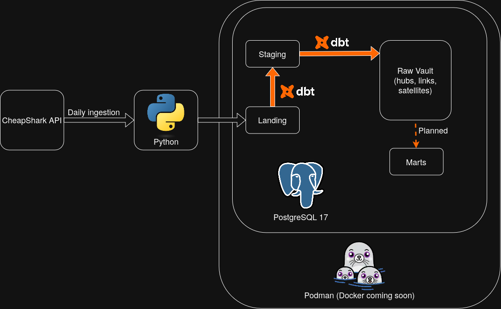
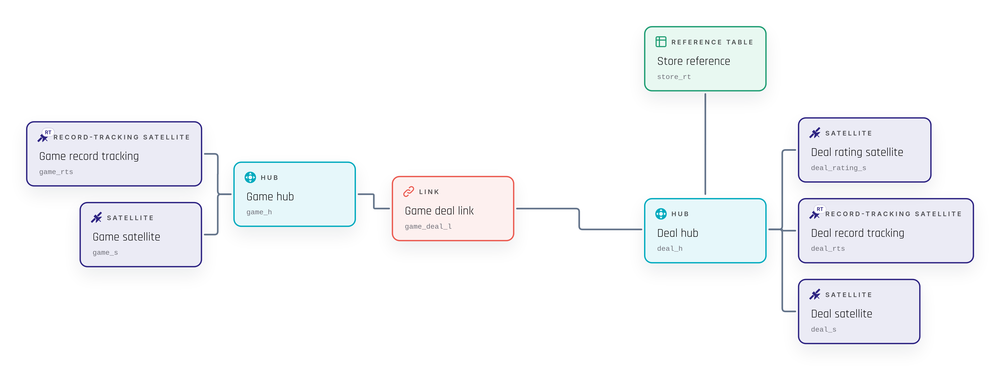

# local-data-platform (work in progress)

A small local data platform built with Python, dbt and Data Vault 2.1, running on a single machine. It ingests price data for PC games from the public CheapShark API and models it so that price changes can be tracked over time across stores.

## Current status

- **Ingestion:** a Python script pulls game deals from the CheapShark API for four stores (Steam, GOG, Epic Games Store, Humble Store) and stores every response untouched in PostgreSQL (`landing` layer, one row per response, JSON payload plus request metadata). It is run manually for now. Scheduling is planned with Airflow.
- **Staging:** dbt models flatten the JSON into one row per deal (and one row per game) per run, and prepare hash keys and hashdiffs.
- **Raw Vault:** built with the datavault4dbt package. Hubs for deals and games, a link between them, satellites for deal prices, deal ratings and game attributes, record-tracking satellites, and a reference table for stores.
- **Tests and docs:** 18 dbt models and 68 dbt tests, all passing (uniqueness of hash keys and load dates, relationships between satellites and hubs), with descriptions for every Raw Vault model.

## Data model

The model has hubs for games and deals, a link between them, satellites for descriptive attributes (with deal ratings in a separate satellite because they change on almost every run), record-tracking satellites, and a reference table for stores.

## Design decisions

- **Raw responses in the landing layer.** The API response is stored as received (JSON, all values as strings), so parsing and casting happen in dbt and can be changed without calling the API again. The layer is called `landing`, not `raw`, to avoid confusion with the Raw Vault.
- **Price bands.** The API stops at about 50 pages per query, and some stores have more deals than that. Each store is therefore requested in price bands (0-1, 1-2, 2-3, 3-5, 5-10, 10-20, 20-40), and I checked that none of them is truncated.
- **Game-grain staging.** A game appears in several stores and on several pages of the same run, with slightly different values (for example the review count). Feeding the game satellite from the deal-grain stage created two rows with the same key and load date, so games now have their own stage with one row per game per run.
- **Deal rating in its own satellite.** The rating changes on almost every run even when nothing else does, so keeping it in the main deal satellite would store a new row per deal per run for no real change.

## Stack

- Python (requests, psycopg)
- PostgreSQL 17 in a container (Podman)
- dbt with datavault4dbt 2.3.0 and dbt_utils

## Quickstart

Coming soon (a compose file for Podman and Docker is planned).

## Planned

Business vault and marts layer, orchestration (Airflow), BI layer (Grafana), machine learning, CI, and a compose file for Podman and Docker.

## About this project

This is a personal project to practise and expand my knowledge of data engineering, analytics and data science. I write all the code myself. I use Claude through the regular chat interface (free plan) as a tutor for troubleshooting and for planning the workflow, not through Claude Code or any other coding agent.